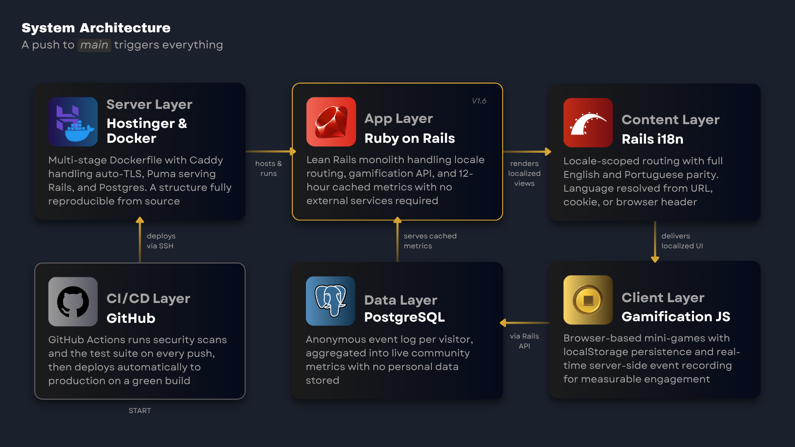
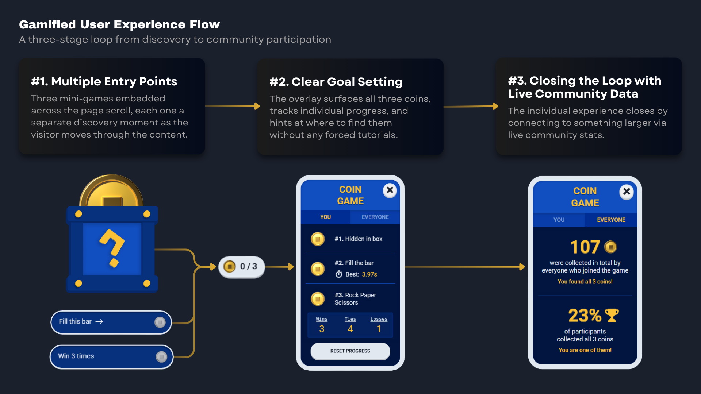

# acoelho.dev

[](https://github.com/ZPAlexis/pzlabs-website-rails/actions/workflows/ci.yml)

**A portfolio website engineered as a real product: localization, tests, CI/CD, security hardening, and a reproducible deployment I fully control. The site is the project.**



Built by Alexis Coelho · [acoelho.dev](https://acoelho.dev) · [LinkedIn](https://linkedin.com/in/coelhoalexis) · **[Read the full case study](https://acoelho.dev/en/projects/acoelho)**

> **Status:** live at [acoelho.dev](https://acoelho.dev), in English and Portuguese. Every push to `main` is tested and deployed by GitHub Actions.

## At a glance

| | |
|---|---|
| **App** | Ruby on Rails 8.1 monolith (Ruby 3.4), PostgreSQL 16, vanilla JavaScript through importmap, no build step |
| **Hosting** | One Hostinger VPS: Caddy (TLS) → Docker Compose → web (Puma) + db (Postgres), on a fixed plan of about $6 USD a month |
| **CI/CD** | GitHub Actions: Brakeman, bundler-audit, importmap audit, RuboCop, unit and system tests, then an SSH deploy that builds the multi-stage Docker image |
| **Languages** | English and Portuguese through Rails i18n, with locale-scoped routes |
| **Engagement** | A coin game across the homepage, backed by an anonymous event API and live community counts |
| **Security** | CSP, rate limiting (Rack::Attack), CSRF protection, model-level validation of every coin event |
| **Tests** | 36 tests: controllers, models, the metrics service, the event API, and a headless-browser system test |

The site also hosts the case studies for my other projects: [JIKO](https://acoelho.dev/en/projects/jiko), [WhatsApp Feed Automation](https://acoelho.dev/en/projects/n8n_whatsapp), Trofy and the game prototypes.

## Three core concepts

1. **A living portfolio.** A production environment that's self-hosted, easily reproducible, and fully under my control, shipping with one `git push`.
2. **Production discipline.** Multi-stage Docker builds, an SSH deployment pipeline, 12-hour API caching, CI security scans, a real test suite, CSP, and rate limiting. More than a personal portfolio needs, on purpose: it's how I'd treat any client's system.
3. **Measurable engagement with gamification.** A coin game that feeds a real API, and a homepage that loops the experience with live global counts.

## Architecture, by layer

| Layer | Flow |
|---|---|
| **CI/CD:** GitHub | GitHub push → Actions (CI: scan + test) → Actions (CD: SSH deploy) |
| **Server:** Hostinger VPS and Docker | Caddy (TLS) → Docker Compose → web (Puma) + db (Postgres) |
| **App:** Ruby on Rails | Locale routing with i18n → Gamification JS ↔ Event API → Metrics caching ↔ PostgreSQL |
| **Content:** Rails i18n | Locale-scoped routes, every string in YAML ([`config/locales`](config/locales)) |
| **Client:** gamification JS | Three mini-games and a shared game state, in vanilla JS ([`app/javascript`](app/javascript)) |
| **Data:** PostgreSQL | Each visitor's progress in their browser's localStorage; an anonymous event log in Postgres for the community totals |

## How it evolved: three phases

The hosting and back-end changed twice, each time in response to a real constraint, and always toward less complexity and cost without losing control.

| Phase | Stack | Why it moved on |
|---|---|---|
| **1. GitHub Pages, no back-end** ([`pzlabs-website`](https://github.com/ZPAlexis/pzlabs-website)) | Raw HTML, JavaScript and CSS | The game had no closing step: visitors collected coins but couldn't see community impact. A real API was needed |
| **2. AWS + GitHub Pages** ([`pzlabs-server`](https://github.com/ZPAlexis/pzlabs-server)) | A Node.js/Express API on EC2, MySQL on RDS | Two managed services for a one-person project, at around $40 USD a month with no ceiling on future costs |
| **3. Hostinger VPS + Rails** (this repo, current) | A Rails monolith with PostgreSQL, Docker Compose and Caddy | — |

Phase 3 consolidated everything into one reproducible environment. It removed the external API's round trip and the EC2 and RDS running costs, and it let the community counter update on every collection, with no reload or polling. Railway was evaluated; a VPS gives full visibility into the environment and room to add services. The full story, with diagrams: [Evolution](https://acoelho.dev/en/projects/acoelho#evolution).

## Decisions I deliberately made

1. **Bilingual i18n** with locale-scoped [routes](config/routes.rb) (`scope '(:locale)', locale: /en|pt/`), so both audiences are served without separate pages or codebases.
2. **A locale detection fallback chain,** URL → cookie → `Accept-Language` header ([`ApplicationController`](app/controllers/application_controller.rb)), so visitors get the right language with no manual selection.
3. **A hand-built CSS design system** driven by one [`tokens.css`](app/assets/stylesheets/tokens.css), with no CSS framework.
4. **A gamified experience** with three mini-games: a hidden coin ([`index.js`](app/javascript/index.js)), a momentum-based fill bar ([`fillBar.js`](app/javascript/logic/fillBar.js)), and rock-paper-scissors ([`rock-paper-scissors.js`](app/javascript/logic/rock-paper-scissors.js)).
5. **An event-tracking API,** `POST /api/record-event` ([`EventsController`](app/controllers/api/events_controller.rb)), recording each coin per anonymous client, which gives the game a measurable end point.
6. **Server-aggregated live metrics** ([`MetricsCalculator`](app/services/metrics_calculator.rb)), surfaced as global counters on the homepage.
7. **A 12-hour Rails cache** on those metrics, so the same values aren't recalculated on every page load.
8. **Cache invalidation on each new collection,** in the same transaction as the coin write, which keeps the counter accurate without a separate step.
9. **An anonymous client identity:** an httpOnly, SameSite=Lax, 1-year UUID cookie. Participation is measured without accounts, consent dialogs or any personal information.
10. **Migrating off AWS** (EC2 + RDS) to a single [Docker](Dockerfile) host, for cost and operational simplicity.
11. **Docker Compose** ([`docker-compose.yml`](docker-compose.yml)) on a single VPS: one consolidated, reproducible environment, deployed on every push.
12. **GitHub Actions CI and a retry-hardened SSH deploy** ([`.github/workflows`](.github/workflows)), so a broken build never reaches production.
13. **Security hardening:** CSP, rate limiting with [Rack::Attack](config/initializers/rack_attack.rb), CSRF, and model-level coin validation ([`CoinEvent`](app/models/coin_event.rb)).

<details>
<summary><b>Rails 8 defaults I adopted</b></summary>

- **Puma and Caddy:** Puma as the application server and Caddy as the reverse proxy, both Rails-friendly defaults for a single-VPS deployment.
- **PostgreSQL:** migrated from MySQL (Phase 2's AWS RDS default), with deeper Active Record support ([`config/database.yml`](config/database.yml)).
- **Vanilla JavaScript for the game:** the [game logic](app/javascript/logic/gameState.js) predates the Rails migration. Stimulus is designed for light server-rendered interactivity, not stateful game loops, so the original approach stayed.
- **A hardened production Docker image:** non-root user, jemalloc and bootsnap precompile ([`Dockerfile`](Dockerfile)), to keep resource use low on a fixed-cost VPS.
- **Solid Cache:** runs off the database for the 12-hour metrics cache, so there's no separate Redis instance.
- **Importmap:** ES modules served without a build step ([`config/importmap.rb`](config/importmap.rb)), with no Node dependency.
- **A PWA manifest,** so mobile visitors can install the site as an app.

</details>

## Gamification and the event API



Visitors find three coins across a single scroll of the homepage: a hidden coin, a momentum-based fill bar that decays when left alone, and rock-paper-scissors. An overlay ties them together. It hints at each coin's location, tracks progress, and shows the community view.

A central [game state](app/javascript/logic/gameState.js) follows one pattern on every collection:
1. update the state;
2. persist it to localStorage;
3. check for completion;
4. record the event on the server;
5. refresh the community metrics.

On the server, coin names are validated against a fixed list, the endpoint is rate-limited, and [`MetricsCalculator`](app/services/metrics_calculator.rb) aggregates the `coin_events` table into community totals, cached for 12 hours.

## CI/CD

Every push to `main` runs [`ci.yml`](.github/workflows/ci.yml):
- the security scans (Brakeman, bundler-audit, importmap audit);
- RuboCop;
- the test suite, including a Selenium headless-browser system test.

[`deploy.yml`](.github/workflows/deploy.yml) then connects over SSH, runs the multi-stage Docker build, and brings the stack up with Docker Compose. Retry logic was added after intermittent SSH timeouts from the GitHub Actions runners.

## Design system

Hand-built rather than Tailwind or Bootstrap, as a chance to develop my own design skills. One [`tokens.css`](app/assets/stylesheets/tokens.css) drives typography, the colour scale, spacing and breakpoints across the games, the project pages and both languages. The mobile-first layout, with a bottom navigation bar on mobile, was designed in Figma before any CSS was written.

## What I learned

- **Right-sizing infrastructure.** Phase 2 taught me that cloud-native can be over-engineered for the wrong scope.
- **Ruby on Rails lets a solo dev run lean.** The monolith meant fewer moving parts to build, monitor and maintain.
- **Gamification really shines when it's measurable.** The game became compelling once it fed a shared, live number.
- **A design-token system pays off across pages.** One token file kept every page, game and language visually coherent.
- **Treating a small project like production is the point.** The habits formed here are the baseline any serious production system demands.

The reasoning behind each: [Learnings](https://acoelho.dev/en/projects/acoelho#learnings).

## Run it locally

It needs Ruby 3.4.12 and PostgreSQL. Chrome is needed for the system tests.

```bash
bundle install
bin/rails db:prepare
bin/dev                # http://localhost:3000
```

```bash
bin/rails test           # unit and integration tests
bin/rails test:system    # the headless-browser system test
```

Production runs the same app through [`docker-compose.yml`](docker-compose.yml) and [`Caddyfile`](Caddyfile). Its secrets live in GitHub Actions and on the server, never in the repo.

## Where things live

| Path | What |
|---|---|
| [`app/views/pages`](app/views/pages) | Every page, the project case studies included |
| [`config/locales`](config/locales) | All copy, in English and Portuguese |
| [`app/javascript/logic`](app/javascript/logic) | The mini-games and the shared game state |
| [`app/controllers/api/events_controller.rb`](app/controllers/api/events_controller.rb) | The event API |
| [`app/services/metrics_calculator.rb`](app/services/metrics_calculator.rb) | Community totals and their cache |
| [`app/assets/stylesheets/tokens.css`](app/assets/stylesheets/tokens.css) | The design tokens |
| [`.github/workflows`](.github/workflows) | CI and deploy |
